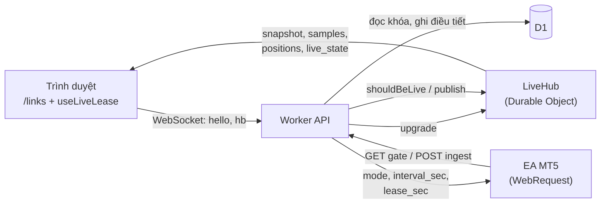
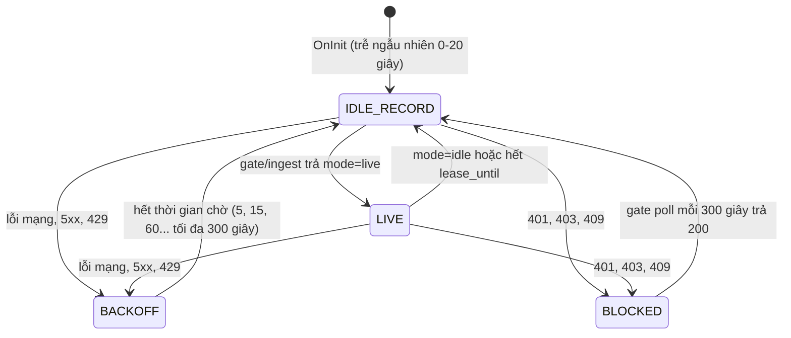

# AZ Sentinel — Plan 3B: Live theo yêu cầu (EA chỉ gửi khi có người xem `/links`)

> Bản nháp v0.1 · 20/10/2026 · Nằm giữa Part 3 (ingest và EA) và Part 4 (web MVP và deploy).
> Phải xong và qua toàn bộ test ở mục 9–11 trước khi deploy.
> Tham chiếu: `AZ_Sentinel_Plan1_EA.md`, `AZ_Sentinel_Plan2_System_DB.md`, `AZ_Sentinel_Plan3_Implementation.md`, `AZ_Sentinel_Rules_BE.md`, `AZ_Sentinel_Rules_FE.md`.

## 1. Mục tiêu, phạm vi và nguyên tắc

EA chỉ gửi dữ liệu lên server khi có ít nhất một người dùng đã đăng nhập đang mở và đang nhìn thấy trang `/links`. Ngoài lúc đó EA chỉ ghi nhận cục bộ và đóng băng việc gửi.

Nguyên tắc:

1. **Live có nhịp, không theo tick.** Mặc định gửi mỗi 10 giây (server chỉnh được, kẹp 3–30 giây). EA lấy mẫu mỗi 1 giây vào bộ đệm và gửi cả lô, không bao giờ gọi mạng trong `OnTick`.
2. **Người xem quyết định.** Vào `/links` thì tự bật live; rời trang, đổi tab, ẩn cửa sổ, đăng xuất hoặc mất kết nối thì server thu hồi quyền live và EA dừng trong tối đa một nhịp.
3. **Có công tắc an toàn ở cả hai đầu.** Server chỉ cấp live theo "lease" ngắn hạn. Nếu EA không nhận được gia hạn thì tự dừng (dead-man switch), kể cả khi server hay mạng im lặng.
4. **Live không ghi D1 theo từng mẫu.** Dữ liệu live đi thẳng tới trình duyệt qua Durable Object. D1 chỉ nhận nến M5 do server tự lấy mẫu từ luồng, sự kiện giao dịch, và `link_state` ghi điều tiết (tối đa 1 lần mỗi 60 giây mỗi liên kết).
5. **Mọi thứ đo được trước khi deploy.** Xong và qua đủ test BE, FE, EA, E2E thì mới sang Part 4.

Phạm vi gồm: giao thức gate và lease, mở rộng ingest, `LiveHub` (Durable Object) và WebSocket cho FE, máy trạng thái EA, hook `useLiveLease` ở FE, ngân sách request, bộ test. Ngoài phạm vi: đăng nhập thật (Part 2), cảnh báo Telegram (Part 5), lịch sử lệnh và biểu đồ equity chi tiết.

## 2. Ràng buộc kỹ thuật và quyết định cần chốt

"Không ai xem thì 0 request" không đạt được nếu muốn live tự bật khi người dùng vào `/links`: MT5 không nhận được push từ server, nên EA phải tự hỏi ít nhất một lần mỗi chu kỳ. Mức tối thiểu là một request "gate" rất nhẹ, thưa, không ghi D1.

Ràng buộc đã biết:

- `WebRequest` chỉ gửi đi (outbound), chặn luồng EA, không dùng được trong Strategy Tester. Server không thể gọi ngược vào EA.
- Free plan Cloudflare: 100.000 request Worker/ngày; Durable Object 100.000 request/ngày; D1 100.000 dòng ghi/ngày; Worker 10 ms CPU/request. Nguồn: [Workers limits](https://developers.cloudflare.com/workers/platform/limits), [DO pricing](https://developers.cloudflare.com/durable-objects/platform/pricing), [D1 pricing](https://developers.cloudflare.com/d1/platform/pricing/).
- WebSocket tới Durable Object: tin nhắn đến tính tỷ lệ 20:1, tin đi và ping giao thức không tính, DO rảnh không bị tính thời gian chạy nếu dùng Hibernation API.
- Rules FE hiện cấm poll dưới 30 giây và đặt WebSocket ở Part 6. Plan này kéo WebSocket lên trước deploy, nên phải sửa Rules FE mục 5 và 14 (thay poll bằng WebSocket trên `/links`, không chạy song song).
- Đăng nhập hiện là giả lập (màn hình ghi "Root Admin (giả lập)", route `/api/dev/links`). Phần xác thực WebSocket phải cắm qua một adapter để dùng tạm auth giả ở dev và chuyển sang session cookie thật khi Part 2 xong.

Phương án cho việc EA biết có người xem (số request tính cho 30 EA chạy cả ngày, là con số tự tính):

| Phương án | Request/ngày (30 EA) | Trễ tối đa để vào live | Nhận xét |
|---|---|---|---|
| A. Gate poll mỗi 120 giây | 21.600 | 120 giây | **Đề xuất mặc định.** Cân bằng giữa hao request và độ trễ |
| B. Gate poll mỗi 60 giây | 43.200 | 60 giây | Chiếm 43% hạn mức request free chỉ để chờ |
| C. Gate poll thích nghi | 21.600 + khoảng 25 mỗi "cửa sổ ấm" mỗi EA | 20 giây trong cửa sổ ấm, 120 giây ngoài | Sau lần có người xem gần nhất, poll 20 giây trong 10 phút (30 lần thay vì 5). Hợp khi người dùng hay quay lại. Nên làm sau khi A đã ổn |
| D. Không poll (0 request) | 0 | Không tự bật được | EA không biết có người xem; chỉ bật live bằng tay trên EA. Không đúng yêu cầu |
| E. Socket TCP giữ kết nối để server đẩy xuống | chưa đo | gần tức thì | MQL5 có `SocketCreate`/`SocketSend` nhưng chưa kiểm chứng với Cloudflare. Chỉ làm spike riêng, không nằm trong plan này |

Các quyết định cần bạn chốt trước khi bắt đầu:

| # | Quyết định | Đề xuất | Hệ quả nếu chọn |
|---|---|---|---|
| Q1 | Chu kỳ gate poll khi không ai xem | 120 giây (phương án A), cửa sổ ấm để sau | Người dùng vào `/links` phải chờ tối đa 120 giây mới thấy live; trong lúc đó FE hiện số liệu gần nhất từ D1 kèm nhãn "đang đánh thức EA" |
| Q2 | Khi không ai xem, sự kiện giao dịch xử lý thế nào | Giữ cục bộ, gửi bù ở phiên live kế tiếp (đối chiếu lịch sử deal từ lần ack cuối) | Đúng yêu cầu. Đổi lại: bảng `trades` và `equity_m5` không có dữ liệu mới trong lúc không ai xem; cảnh báo offline và Telegram (Part 5) sẽ phải dựa vào gate poll làm nhịp tim |
| Q3 | Nhịp live mặc định | 10 giây, kẹp 3–30 giây, lấy mẫu 1 giây | Biểu đồ mượt như mỗi giây mà request giảm 10 lần; không nhanh như `OnTick`. Ở 5 giây, 30 EA live liên tục chỉ đủ khoảng 3,6 giờ/ngày trên free plan (xem mục 8) |
| Q4 | Nút Live | Tự bật khi vào `/links`, có nút Tạm dừng/Tiếp tục, nhớ lựa chọn trong `localStorage` | Người dùng tắt live khi chỉ cần xem tĩnh; tiết kiệm request hơn |
| Q5 | Admin xem EA của người khác | Chờ quyết định Part 2 (câu hỏi mở số 2 của Plan 2); hub lưu phạm vi xem theo từng kết nối nên hỗ trợ cả hai | Không chặn việc làm Plan này |

## 3. Kiến trúc tổng thể

Ba luồng chính:

1. **Người xem vào:** trình duyệt mở WebSocket tới hub; hub đếm viewer và đánh dấu các liên kết của người đó là "cần live".
2. **EA hỏi gate (đang `IDLE_RECORD`):** Worker đọc D1 để xác thực khóa (một lần đọc theo `key_hash`), hỏi hub `shouldBeLive(linkId)`, trả `mode`. Không ghi D1 ngoài việc cập nhật `last_seen_at` tối đa 1 lần mỗi 240 giây.
3. **EA gửi live (đang `LIVE`):** Worker xác thực khóa, gọi `hub.publish(linkId, mẫu)`; hub phát cho viewer và trả lại `wanted`; Worker phản hồi cho EA (gia hạn lease hoặc `idle`). D1 chỉ ghi theo quy tắc ở mục 7.

## 4. Giao thức

Giao thức thêm hai thứ vào schema `v:1` hiện có theo kiểu cộng thêm (trường mới đều tùy chọn, server vẫn nhận payload cũ của `AZ_Spike`): một endpoint `gate` cho EA hỏi "có người xem không", và một kênh WebSocket cho trình duyệt.

**EA → server**

| Endpoint | Khi nào | Ghi D1 | Phản hồi |
|---|---|---|---|
| `GET /api/ea/v1/gate` (`X-API-Key`) | EA ở `IDLE_RECORD`, mỗi `next_poll_sec` | Không; chỉ cập nhật `last_seen_at` tối đa 1 lần mỗi 240 giây | `{mode, interval_sec, lease_sec, next_poll_sec, server_time}` |
| `POST /api/ea/v1/ingest` với `reason:["live"]` | EA ở `LIVE`, mỗi `interval_sec` | `link_state` điều tiết, nến M5 do server lấy mẫu, sự kiện giao dịch | `ack_seq` + các trường của `gate` |
| `POST /api/ea/v1/ingest` với `reason:["backfill"]` | Một lần khi vào `LIVE`, nếu còn dữ liệu chưa gửi | Sự kiện giao dịch bù; nến M5 bù (tối đa 288 dòng, `INSERT OR IGNORE`) | như trên |

Trường mới trong ingest (đều tùy chọn): `samples` tối đa 20 phần tử dạng `{t, eq, bal, fl, ml}` (`t` là Unix giây, `ml` có thể null); `pos_hash` (EA chỉ gửi lại `positions` khi hash đổi). Trường mới trong phản hồi: `mode` (`live` hoặc `idle`), `interval_sec` (kẹp 3–30, mặc định 10), `lease_sec` (mặc định 45), `next_poll_sec` (mặc định 120). `sid`/`seq` và loại trùng giữ nguyên; mẫu trùng bị bỏ theo `t`.

**Lease:** mỗi phản hồi có `mode:"live"` gia hạn quyền live thêm `lease_sec`. EA lưu `lease_until`; quá hạn mà chưa được gia hạn thì tự về `IDLE_RECORD`. Phản hồi `mode:"idle"` dừng live ngay. Vì vậy khi người xem rời đi, EA dừng sau tối đa một nhịp (10 giây); khi mạng hoặc server hỏng, EA dừng sau tối đa 45 giây.

**Trình duyệt ↔ server:** `GET /api/live/ws` (nâng cấp WebSocket, cookie phiên, kiểm tra `Origin`). Mở kết nối tức là đang xem; đóng kết nối tức là thôi xem.

| Hướng | Tin nhắn | Nội dung |
|---|---|---|
| FE → server | `hello` | `{t:"hello", scope:"links"}` sau khi mở |
| FE → server | `hb` | `{t:"hb"}` mỗi 25 giây; hub coi viewer chết nếu 60 giây không có tin (cắt mạng đột ngột không gửi được `close`) |
| server → FE | `snapshot` | trạng thái hiện tại của các liên kết người này được xem, kèm `live_state` từng liên kết |
| server → FE | `samples` | `{t:"samples", id, samples:[...]}` mỗi lần EA gửi lô |
| server → FE | `positions` | `{id, positions, pos_hash}` khi đổi |
| server → FE | `live_state` | `waking` (có người xem, EA chưa vào live), `live`, `idle` (EA chưa phản hồi) |
| server → FE | `kick` | `{reason}`: `session_expired`, `too_many_tabs`; FE không tự nối lại |

Tin `hb` tính theo tỷ lệ 20:1 nên khoảng 3.456 tin/ngày mỗi người xem liên tục cả ngày thành khoảng 173 request quy đổi. Tin `samples` chạy từ server đi, không tính phí.

## 5. Máy trạng thái EA

| Trạng thái | EA làm gì | EA không làm gì |
|---|---|---|
| `IDLE_RECORD` | Mỗi 1 giây lấy mẫu vào bộ đệm (nến M5 equity tối đa 288 điểm, trong bộ nhớ); `OnTradeTransaction` ghi sự kiện vào hàng đợi cục bộ và lưu mốc `last_ack_deal_time`; mỗi `next_poll_sec` gửi một `GET gate` | Không `POST ingest` |
| `LIVE` | Mỗi 1 giây lấy mẫu; mỗi `interval_sec` (tối thiểu 3 giây) gửi một `POST ingest` chứa tối đa 20 mẫu, `positions` chỉ khi `pos_hash` đổi, kèm sự kiện giao dịch đang chờ; vào `LIVE` thì gửi `backfill` một lần nếu có dữ liệu chưa gửi | Không gọi mạng trong `OnTick` |
| `BACKOFF` | Chỉ ghi nhận cục bộ, chờ theo khoảng tăng dần | Không gửi gì |
| `BLOCKED` | Hiện cảnh báo trên chart, gate poll mỗi 300 giây | Không ingest |

Quy tắc an toàn:

- **Dead-man switch:** `lease_until` hết hạn thì về `IDLE_RECORD`, không cần chờ lệnh từ server.
- **Sàn nhịp:** không bao giờ gửi dưới 3 giây một request; trần `InpLiveMaxPerHour` (mặc định 1.200, tương ứng sàn 3 giây) là giới hạn cứng.
- **Mất sự kiện giao dịch:** hàng đợi cục bộ lưu `last_ack_deal_time` bằng biến toàn cục của terminal; khi khởi động lại hoặc vào live, EA đối chiếu lịch sử deal từ mốc này và gửi bù (cơ chế Plan 1 mục 6). Server loại trùng bằng deal ticket và position id.
- **Khởi động lại terminal:** `sid` mới, vào `IDLE_RECORD`, trễ ngẫu nhiên 0–20 giây trước gate poll đầu tiên để 30 EA không bắn cùng một giây.
- **`WebRequest` chặn luồng:** timeout 3 giây; bộ đệm mẫu cho phép bù lại khi `OnTimer` bị trễ.

Input mới cho EA:

| Input | Mặc định | Ý nghĩa |
|---|---|---|
| `InpIdlePollSec` | 120 | Chu kỳ gate poll ban đầu (server ghi đè bằng `next_poll_sec`, tối thiểu 30) |
| `InpLiveMinIntervalSec` | 3 | Sàn nhịp live |
| `InpLiveMaxPerHour` | 1200 | Trần cứng số request live mỗi giờ |
| `InpBackfill` | true | Gửi bù nến M5 và sự kiện ở đầu phiên live |

## 6. Flow FE

Một hook `useLiveLease` (đặt trong `FE/src/features/links/live/`) điều khiển toàn bộ vòng đời kết nối. Kết nối WebSocket chỉ mở khi **đủ bốn điều kiện**: đang ở route `/links`, đã đăng nhập, công tắc Live đang bật, và `document.visibilityState === 'visible'`. Mất một điều kiện thì đóng kết nối.

| Sự kiện | FE làm gì | Hệ quả ở server và EA |
|---|---|---|
| Vào `/links` | Gọi danh sách từ D1 một lần để có số liệu ngay, rồi mở WebSocket, gửi `hello` | Hub đếm thêm viewer; liên kết chuyển `waking`; EA vào live ở lần gate poll kế tiếp (tối đa 120 giây) |
| Tab đổi sang ẩn | Đặt hẹn 10 giây (grace). Hết hẹn mà vẫn ẩn thì đóng WebSocket mã 1000 và dừng cập nhật giao diện | Viewer giảm. Nếu về 0 thì phản hồi ingest kế tiếp của EA là `idle` (tối đa 10 giây) |
| Quay lại tab trong 10 giây | Hủy hẹn, không đổi gì | Không đổi. Tránh đóng mở liên tục khi người dùng lướt qua lại giữa các tab |
| Quay lại sau khi đã đóng | Gọi danh sách từ D1 một lần, mở lại WebSocket | Như dòng "Vào `/links`" |
| Rời route `/links` (unmount) | Đóng WebSocket ngay, không grace | Như dòng "Tab đổi sang ẩn", nhưng không chờ 10 giây |
| Đóng tab, đóng trình duyệt (`pagehide`) | Đóng WebSocket; không gửi thêm gì | Nếu trình duyệt không kịp gửi `close`, hub nhận ra sau 60 giây không có `hb` |
| Đăng xuất hoặc nhận 401 | Đóng WebSocket, xóa cache danh sách, về trang đăng nhập | Hub gửi `kick: session_expired` nếu kết nối còn |
| Bấm Tạm dừng | Đóng WebSocket, lưu `paused` vào `localStorage`, không tự poll; có nút Làm mới để gọi danh sách từ D1 | Như dòng "Tab đổi sang ẩn" |
| Không thao tác 10 phút (chuột, phím, chạm, cuộn) | Tự tạm dừng, hiện banner "Tạm dừng do không thao tác" kèm nút Tiếp tục | Như dòng "Bấm Tạm dừng". Chặn trường hợp để tab mở cả ngày mà không ai nhìn |
| Mất mạng (`offline`, lỗi socket) | Nối lại theo backoff 1, 2, 4, 8, 16, 30 giây có jitter; tối đa 8 lần rồi hiện trạng thái `disconnected` kèm nút Thử lại; khi sự kiện `online` bật lại thì nối ngay | Viewer rớt sau 60 giây; EA dừng ở lần phản hồi `idle` hoặc khi hết lease |
| Máy ngủ rồi thức | Nhận `visibilitychange` hoặc `online` thì nối lại như "Quay lại sau khi đã đóng" | Như trên |
| Mở nhiều tab `/links` | Mỗi tab đang hiện tự mở kết nối của mình | Tối đa 3 kết nối mỗi người dùng; kết nối thứ 4 bị `kick: too_many_tabs`. Tab ẩn đã đóng nên không tính |

Giao diện: thanh tiêu đề có nút Live với bốn trạng thái (`Đang chạy · 10 giây`, `Đang đánh thức EA`, `Tạm dừng`, `Mất kết nối`). Mỗi hàng có huy hiệu `Live`, `Đang đánh thức` hoặc `Không phản hồi` dùng `live_state` từ server, và dấu thời gian "cập nhật X giây trước" tính từ `server_time`, không từ đồng hồ máy người dùng. Tin `samples` và `positions` ghi thẳng vào cache TanStack Query (`setQueryData` trên khóa `['links']`); trong lúc WebSocket đang nối, `useLinks` tắt `refetchInterval` để không chạy song song poll và WebSocket (đúng Rules FE mục 5).

## 7. Flow BE

Thành phần mới:

| Tệp | Vai trò |
|---|---|
| `BE/src/live/live-hub.ts` | Durable Object `LiveHub`, một instance toàn cục (`idFromName('global')`) |
| `BE/src/routes/live-ws.ts` | `GET /api/live/ws`: xác thực người xem, kiểm tra `Origin`, chuyển yêu cầu nâng cấp cho hub |
| `BE/src/routes/ea-gate.ts` | `GET /api/ea/v1/gate` |
| `BE/src/services/live-service.ts` | Xử lý ingest chế độ live, gate, lease, điều tiết ghi |
| `BE/src/live/viewer-auth.ts` | Adapter xác thực người xem: auth giả ở dev, session cookie thật sau Part 2 |
| `Shared/src/live-schema.ts` | Schema zod cho `samples`, `pos_hash`, phản hồi gate, tin nhắn WebSocket |
| `BE/wrangler.jsonc` | Thêm binding DO và migration `new_sqlite_classes` |

Trạng thái của hub: danh sách kết nối `{connId, userId, role, scope, lastBeatAt}` (lưu bằng `serializeAttachment` để sống sót qua hibernation), `wanted(linkId)` tính từ các kết nối còn sống, mẫu cuối và `lastT` của từng liên kết, `lastIngestAt` và `lastStateWriteAt` của từng liên kết (trong bộ nhớ). Kết nối còn sống nếu `lastBeatAt` chưa quá 60 giây; hub dọn kết nối chết **một cách lười** mỗi khi có gate hoặc ingest, không dùng `setInterval` hay alarm vì chúng chặn hibernation.

Quy tắc xử lý:

1. **Gate:** xác thực khóa (một lần đọc D1), hỏi `hub.shouldBeLive(linkId)`, trả `mode`. Hub lỗi hoặc quá thời gian thì trả `mode:"idle"` (fail-closed: lỗi luôn làm EA ngừng gửi, không bao giờ làm nó gửi thêm).
2. **Ingest live:** xác thực, zod, loại trùng `sid/seq`, kiểm tra rate limit (tối thiểu 2 giây giữa hai ingest của cùng một liên kết, vi phạm trả 429 kèm `Retry-After: 2`), gọi `hub.publish`. Nếu `wanted` là false thì trả `mode:"idle"` và không phát gì.
3. **Ghi D1 trong live:** `link_state` chỉ ghi khi đã qua 60 giây kể từ lần ghi trước, hoặc `pos_hash` đổi, hoặc có sự kiện giao dịch; nến M5 do **server** chọn mẫu gần ranh giới 5 phút nhất theo giờ nhận (không tin `t` của EA), `INSERT OR IGNORE`; sự kiện giao dịch upsert như hiện tại. Tất cả trong một `DB.batch()`.
4. **Ghi D1 khi idle:** chỉ cập nhật `last_seen_at` tối đa 1 lần mỗi 240 giây; nếu `presence = 1` thì cùng batch đặt `presence = 0` và chèn sự kiện `online` (logic ingest hiện tại).
5. **Tin cậy dữ liệu EA:** `t` của mẫu chỉ dùng cho trục thời gian của biểu đồ; nếu lệch quá 120 giây so với giờ nhận thì server thay bằng giờ nhận. `samples` tối đa 20, `positions` tối đa 200, body tối đa 64 KB (giữ giới hạn hiện có).
6. **Xác thực người xem:** từ chối nâng cấp WebSocket nếu không có phiên (401) hoặc `Origin` sai (403); tối đa 3 kết nối mỗi người dùng. Phạm vi xem do `viewer-auth` quyết định: chủ sở hữu chỉ thấy liên kết của mình; vai trò admin xem rộng hơn khi quyết định Q5 được chốt.
7. **Khóa bị khóa giữa lúc live:** ingest kế tiếp trả 403 (như hiện tại); hub ngừng phát cho liên kết đó.
8. **Chỉ mục:** không thêm chỉ mục nào mới (Rules BE mục 6). Mọi đường ghi mới ghi chú số dòng ghi dự kiến ở `db/sql.ts`.

## 8. Ngân sách request và dòng ghi

Con số dưới đây là ước tính cho 30 EA, dựa trên hạn mức free đã nêu ở mục 2. Phải đo lại bằng test E-07 và ghi vào `Docs/spike-results.md`.

**Nền (không ai xem, 24 giờ):**

| Hạng mục | Mỗi ngày | Cách tính |
|---|---|---|
| Request Worker (gate) | 21.600 | 30 EA × 86.400 ÷ 120 |
| Request Durable Object | 21.600 | mỗi gate hỏi hub một lần |
| Dòng ghi D1 | 10.800 | `last_seen_at` mỗi 240 giây: 30 × 360 |
| Dòng đọc D1 | 21.600–43.200 | 1–2 dòng mỗi gate (tra khóa) |

**Live, mỗi EA:** ở nhịp 10 giây là 360 request/giờ (8.640/ngày nếu live liên tục 24 giờ) và 72 dòng ghi D1/giờ (60 `link_state` + 12 nến M5).

**Số giờ mỗi ngày có thể chạy live cho cả 30 EA** (sau khi trừ nền 21.600; mỗi ingest tốn 1 request Worker và 1 request DO, nên hai hạn mức cùng chạm một lúc; chưa tính request dashboard, dùng hết 100% hạn mức, không chừa biên):

| Nhịp live | Request/phút (30 EA) | Số giờ tối đa mỗi ngày |
|---|---|---|
| 3 giây | 600 | 2,2 |
| 5 giây | 360 | 3,6 |
| 10 giây | 180 | 7,3 |
| 15 giây | 120 | 10,9 |
| 30 giây | 60 | 21,8 |

Ở ngưỡng cảnh báo 70% (Plan 2 mục 11), nhịp 10 giây còn khoảng 4,5 giờ/ngày cho cả 30 EA: (70.000 − 21.600) ÷ 180 ≈ 269 phút. Vì vậy Q3 chọn 10 giây và FE có tạm dừng khi không thao tác.

**Ví dụ:** cả 30 EA live 3 giờ/ngày ở nhịp 10 giây thì request Worker là 21.600 + 32.400 = 54.000 (54% hạn mức), request DO tương tự, dòng ghi D1 là 10.800 + 6.480 = 17.280 (17%).

**Dashboard:** thay 2.880 lượt poll/ngày mỗi người (30 giây) bằng 1 lần gọi danh sách + 1 kết nối WebSocket mỗi lần vào, cộng khoảng 173 request quy đổi nếu mở liên tục cả ngày.

Điểm chưa biết, phải đo: `INSERT OR IGNORE` trùng khóa có tính dòng ghi không (ảnh hưởng ngân sách `backfill`); số dòng đọc thực tế của gate; CPU p99 của ingest live trên Cloudflare.

## 9. Case kiểm thử BE

Chạy bằng Vitest (đã dùng ở `BE/test`), D1 local, mỗi test đường ghi kiểm `meta.rows_written` (Rules BE mục 11).

| ID | Case | Kỳ vọng |
|---|---|---|
| B-01 | Gate không có khóa, khóa sai, liên kết `disabled` | 401, 401, 403; không ghi D1 |
| B-02 | Gate khi không có viewer | 200, `mode:"idle"`, `next_poll_sec:120` |
| B-03 | Gate khi có viewer | 200, `mode:"live"`, `interval_sec:10`, `lease_sec:45` |
| B-04 | Hai gate cách nhau dưới 240 giây | Tổng `rows_written` ≤ 1 |
| B-05 | Hub lỗi hoặc quá thời gian khi gate | 200, `mode:"idle"` (fail-closed), không 5xx |
| B-06 | Gate khi `presence = 1` | Đặt `presence = 0` và chèn sự kiện `online` đúng 1 lần |
| B-07 | Ingest live khi không còn viewer | 200, `mode:"idle"`, có `ack_seq`; mẫu không được phát |
| B-08 | Ingest live hợp lệ, hai lần trong 60 giây | Mẫu được phát tới viewer; lần 1 ghi `link_state` (1 dòng), lần 2 ghi 0 dòng |
| B-09 | Ingest chạm ranh giới M5; lặp lại cùng nến | +1 dòng `equity_m5`; lặp lại → 0 dòng (đo thực tế, mục 8) |
| B-10 | `samples` > 20, `positions` > 200, body > 64 KB | 400, 400, 413 |
| B-11 | Trùng `sid/seq` | `duplicate:true`, 0 dòng ghi, không phát lại |
| B-12 | Mẫu có `t` ≤ `lastT` của liên kết | Bị bỏ, không phát |
| B-13 | Hai ingest cùng liên kết cách nhau dưới 2 giây | Lần 2 trả 429 kèm `Retry-After` |
| B-14 | `pos_hash` không đổi; `pos_hash` đổi | Không ghi `positions_json`; có ghi khi đổi |
| B-15 | `backfill` 288 mẫu; gửi lại cùng dữ liệu; 289 mẫu | ≤ 288 dòng; 0 dòng; 400 |
| B-16 | Sự kiện giao dịch trong live | Upsert `trades` như đường ingest hiện tại |
| B-17 | Cấu hình `interval_sec` ngoài 3–30 | Bị kẹp vào 3–30 |
| B-18 | Payload cũ của `AZ_Spike` (không có `samples`, `mode`) | Vẫn 200 |
| B-19 | WebSocket không có phiên; `Origin` sai | 401; 403 |
| B-20 | `hello` hợp lệ | `snapshot` chỉ gồm liên kết của chính người xem (User A không thấy liên kết của User B) |
| B-21 | Viewer thứ 4 của cùng một người dùng | `kick: too_many_tabs` |
| B-22 | Đóng kết nối cuối cùng | `shouldBeLive` thành false ngay |
| B-23 | 60 giây không có `hb` (fake timers) | Viewer bị coi là chết; bị dọn ở lần gate hoặc ingest kế tiếp |
| B-24 | Hai viewer; đóng một rồi đóng hai | Vẫn live sau khi đóng một; `idle` sau khi đóng hai |
| B-25 | Phiên hết hạn khi kết nối còn | `kick: session_expired`, đóng kết nối |
| B-26 | Phạm vi xem theo vai trò (khi Q5 chốt) | Admin thấy phạm vi rộng; người dùng thường chỉ thấy của mình |
| B-27 | Hub bị khởi tạo lại (hibernation) | Kết nối khôi phục từ `serializeAttachment`, số viewer đúng |
| B-28 | Snapshot `rows_written` cho gate idle, ingest live, backfill | Khớp bảng mục 8; chặn hồi quy ghi thừa |
| B-29 | Khóa bị khóa giữa lúc live | Ingest kế tiếp trả 403; hub ngừng phát cho liên kết đó |

## 10. Case kiểm thử FE

Vitest và Testing Library với `WebSocket` giả và fake timers (mở rộng `FE/src/test/render-app.tsx`).

| ID | Case | Kỳ vọng |
|---|---|---|
| F-01 | Vào `/links` khi đã đăng nhập | Gọi danh sách 1 lần, mở đúng 1 WebSocket, gửi `hello` |
| F-02 | Chưa đăng nhập; ở route khác (tổng quan, `/links/:id`) | Không mở WebSocket |
| F-03 | Tab ẩn: sau 10 giây; hiện lại ở giây thứ 9 | Đóng ở giây thứ 10; không đóng nếu hiện lại ở giây thứ 9 |
| F-04 | Hiện lại sau khi đã đóng | Gọi danh sách 1 lần và mở lại WebSocket |
| F-05 | Unmount khỏi `/links` | Đóng ngay; không còn timer nào chạy |
| F-06 | `pagehide` | Đóng WebSocket |
| F-07 | Bấm Tạm dừng; tải lại trang; bấm Tiếp tục | Đóng và không poll; vẫn tạm dừng sau khi tải lại; mở lại khi Tiếp tục |
| F-08 | `localStorage` ném lỗi | Hook vẫn chạy với mặc định Live bật, không hỏng trang |
| F-09 | Không thao tác 10 phút; có thao tác ở phút thứ 9 | Tự tạm dừng và hiện banner; thao tác đặt lại bộ đếm |
| F-10 | Mất mạng | Nối lại theo 1, 2, 4, 8, 16, 30 giây (kiểm tra thời điểm); sau 8 lần hiện `disconnected` và nút Thử lại; `online` nối ngay và đặt lại backoff |
| F-11 | `kick: too_many_tabs`, `kick: session_expired`, 401 | Không tự nối lại; hiện thông báo; 401 về trang đăng nhập |
| F-12 | Nhận `samples` | Cache được cập nhật, hàng hiển thị equity mới; `useLinks` không có `refetchInterval` khi WebSocket đang nối |
| F-13 | Nhận `live_state` `waking`, `live`, `idle` | Hiện đúng huy hiệu `Đang đánh thức`, `Live`, `Không phản hồi` |
| F-14 | Đổi đồng hồ giả của trình duyệt | "Cập nhật X giây trước" không đổi (tính từ `server_time`) |
| F-15 | `hb` | Gửi mỗi 25 giây; dừng khi đóng; không rò timer sau unmount |
| F-16 | React StrictMode (mount hai lần ở dev) | Cuối cùng chỉ còn 1 WebSocket |
| F-17 | Nối lại sau khi mất kết nối | Thay cache bằng `snapshot` mới, không trùng mẫu |
| F-18 | Trợ năng | Nút Live có `aria-pressed`; trạng thái đổi được đọc qua vùng `aria-live` |
| F-19 | Bất kỳ lúc nào trong mọi kịch bản trên | Số WebSocket đang mở của một tab không bao giờ lớn hơn 1 |

## 11. Case kiểm thử EA và E2E

**E2E tự động bằng `fake-ea`** (mở rộng `Scripts/fake-ea.ts` thành bộ giả lập máy trạng thái EA, kèm viewer WebSocket giả, đồng hồ tua nhanh; thoát mã 1 nếu sai):

| ID | Case | Kỳ vọng |
|---|---|---|
| E-01 | Không có viewer | Chỉ có gate poll (mỗi 120 giây tua nhanh), **0 ingest** |
| E-02 | Viewer vào | Trong vòng một chu kỳ gate, EA chuyển live; ingest mỗi `interval_sec`; mỗi request ≤ 20 mẫu |
| E-03 | Viewer rời | Trong vòng một nhịp EA dừng; không còn ingest nào sau đó |
| E-04 | Server không trả lời | EA dừng khi hết lease 45 giây |
| E-05 | Server trả 5xx | EA lùi theo 5, 15, 60 giây; không gửi dồn |
| E-06 | Viewer rời rồi quay lại trong 10 giây (grace) | Số ingest không gián đoạn |
| E-07 | 30 fake-ea và 3 viewer giả trong 10 phút tua nhanh | Tổng request, request DO, `rows_written` khớp mục 8 (lệch dưới 30%) |
| E-08 | Nến M5 xếp hàng lúc idle | Gửi `backfill` một lần khi vào live; server ghi ≤ 288 dòng |
| E-09 | Sự kiện giao dịch lúc idle | Gửi bù ở phiên live; không mất, không trùng |
| E-10 | Khởi động lại `wrangler dev` giữa lúc live | EA nhận `idle` hoặc hết lease; viewer nối lại và live tiếp |

**Thử MT5 demo, thủ công:**

| ID | Case | Kỳ vọng |
|---|---|---|
| M-01 | Thêm URL vào Allow WebRequest; gate từ MT5 thật | Mã 200; đo thời gian phản hồi |
| M-02 | Server chậm (timeout 3 giây) | `OnTimer` 1 giây không bị giật quá mức; đo thời gian `OnTimer` p99 |
| M-03 | 30 phút live ở nhịp 10 giây | Số request trong log EA khớp dashboard Cloudflare (lệch dưới 5%) |
| M-04 | Tắt và mở lại terminal giữa lúc live | `sid` mới; không trùng, không mất sự kiện |
| M-05 | 200 lệnh mở | Ghi nhận kích thước payload và thời gian dựng JSON |
| M-06 | Cuối tuần hoặc thị trường đóng cửa | Mẫu vẫn chạy (equity không đổi); request vẫn gửi để gia hạn lease |

## 12. Phân rã công việc

Ký hiệu như Plan 3: **[Claude viết, Bạn chạy]**, **[Bạn thao tác]**, **[Cả hai]**.

| Bước | Việc | Phụ thuộc | Xong khi |
|---|---|---|---|
| L0 | Chốt Q1–Q5; sửa Rules FE mục 5 và 14, Plan 2 mục 8 và Plan 3 mục 7 (kéo WebSocket từ Part 6 lên trước deploy) **[Cả hai]** | | Quyết định được ghi vào Plan |
| L1 | `Shared/src/live-schema.ts` và test **[Claude viết, Bạn chạy]** | L0 | Test schema xanh |
| L2 | BE: gate, `live-service`, ghi điều tiết, adapter xác thực giả **[Claude viết, Bạn chạy]** | L1 | B-01 đến B-18 xanh |
| L3 | BE: `LiveHub`, route WebSocket, binding và migration DO **[Claude viết, Bạn chạy]** | L2 | B-19 đến B-29 xanh |
| L4 | `fake-ea` thành máy trạng thái, viewer giả **[Claude viết, Bạn chạy]** | L3 | E-01 đến E-06 xanh |
| L5 | FE: `useLiveLease`, nút Live, huy hiệu, banner **[Claude viết, Bạn chạy]** | L3 | F-01 đến F-19 xanh |
| L6 | EA: máy trạng thái live, input mới, backfill **[Claude viết, Bạn chạy trên MT5 demo]** | L3 | M-01 đến M-06 đạt |
| L7 | Đo ngân sách: E-07, E-08 đến E-10, `rows_written`, request DO; ghi vào `Docs/spike-results.md` **[Cả hai]** | L4, L5, L6 | Lệch dưới 30% so với mục 8 |
| L8 | Cửa GO sang Part 4 **[Cả hai]** | L7 | Mọi ô dưới đây đạt |

Tiêu chí hoàn thành toàn Plan (cửa GO):

- [ ] Toàn bộ test B, F, E xanh; M-01 đến M-06 đạt trên MT5 demo.
- [ ] E-01 khẳng định 0 ingest khi không có viewer.
- [ ] E-03 và E-04 chứng minh EA dừng trong một nhịp (viewer rời) và trong 45 giây (mất server).
- [ ] Ngân sách mục 8 đo lại, lệch dưới 30%; mục "chưa biết" ở mục 8 có số đo thật.
- [ ] 3 EA demo chạy 2 giờ có viewer và 2 giờ không viewer, số request khớp dashboard.
- [ ] Rules FE và Plan 2 đã cập nhật theo L0.

## 13. Rủi ro và câu hỏi mở

Rủi ro:

- **Hạn mức khi nhiều EA live cùng lúc.** Ở nhịp 5 giây, 30 EA chỉ chạy được khoảng 3,6 giờ/ngày trên free plan. Giảm thiểu: nhịp mặc định 10 giây, tạm dừng khi không thao tác, tiến tới nâng Workers Paid ($5/tháng) nếu cần.
- **Gate poll luôn tốn request dù không ai dùng** (21.600/ngày ở 120 giây). Chỉ giảm được bằng chu kỳ dài hơn hoặc phương án E (socket) sau này.
- **Một Durable Object toàn cục.** Đủ cho 30 EA; nếu tăng thì tách theo chủ sở hữu (`idFromName('owner:' + id)`).
- **Phụ thuộc Part 2.** Xác thực WebSocket thật chỉ có khi Part 2 xong; trước đó dùng adapter giả, nên test B-19 đến B-26 phải chạy lại sau Part 2.
- **Hibernation.** Không dùng `setInterval`, `ws.accept()` hay `fetch` đang chờ trong hub; trạng thái bộ nhớ mất khi ngủ đông nên phải dùng `serializeAttachment`; kết nối chết chỉ được phát hiện bằng `hb`, không bằng `close`.
- **`WebRequest` chặn luồng.** Mỗi request live có thể chặn EA tới 3 giây nếu server chậm; đo ở M-02.
- **Giờ VPS lệch.** Server không tin `t` của EA (mục 7, quy tắc 5).
- **Ghi D1 khi `INSERT OR IGNORE` trùng khóa** chưa biết có tính dòng ghi hay không; đo ở B-09 và B-15.

Câu hỏi mở (ngoài Q1–Q5):

1. Grace 10 giây khi tab ẩn có phù hợp không, hay muốn dừng ngay?
2. Idle timeout 10 phút có phù hợp không?
3. Trang chi tiết `/links/:id` có cần live nhanh hơn (ví dụ 5 giây cho một EA) không? Plan này chỉ làm live cho trang danh sách `/links`.
