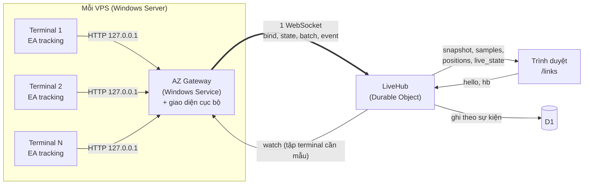
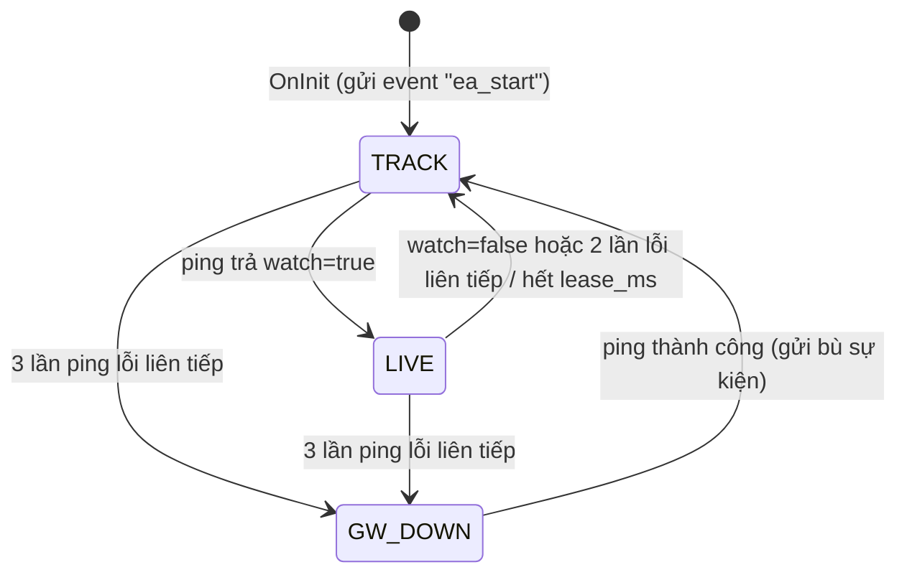

# AZ Sentinel — Plan 3C: Cổng cục bộ (Gateway) trên mỗi VPS và EA tracking trong từng terminal

> Bản nháp v0.1 · 21/10/2026 · Thay thế phần "EA hỏi gate qua internet" của `AZ_Sentinel_Plan3B_Live_On_Demand.md`. Giữ nguyên phần viewer WebSocket, `LiveHub`, `useLiveLease` đã làm.
> Chưa có mã nào của Plan này được viết. Patch 05 (xóa Python) và patch 06 (tài liệu này) là hai patch duy nhất tới thời điểm này.

## 0. Vì sao đổi hướng

Plan 3B để mỗi EA tự gọi `GET /gate` qua internet mỗi 120 giây để biết "có người xem không". Điều đó tốn 21.600 request Worker và 10.800 dòng ghi D1 mỗi ngày dù không ai mở web, và trễ tối đa 120 giây mới vào live.

Thử dùng gói Python `MetaTrader5` để đọc terminal (thay cho EA) đã **thất bại** trên máy phát triển:

| Quan sát (21/10/2026) | Giá trị |
|---|---|
| Terminal | MT5 build 6230 (25/9/2026), đăng nhập Exness demo, kết nối bình thường, lệnh vẫn khớp |
| Gói Python | `MetaTrader5` 5.0.6231, Python 3.12.10 64-bit |
| Lỗi | `-10003 IPC initialize failed, Pipe server didn't answer in 60 sec`, cả có `path` lẫn không |
| Đã loại trừ | Lệch quyền (cả hai không elevated, cùng user Admin), đóng gói `.exe` (lỗi y hệt bằng Python thường), terminal chưa đăng nhập |
| Bên ngoài | Một báo cáo trên diễn đàn MQL5 (khoảng 3 tuần trước) cho lỗi tương tự với terminal build 6231, chưa có lời giải |

Chưa xác định được nguyên nhân gốc, và không cần xác định: đường đọc dữ liệu qua giao thức nội bộ của MetaQuotes có thể hỏng ở mỗi lần terminal tự cập nhật, trên hàng chục VPS cùng lúc. EA dùng API MQL5 có tài liệu nên ổn định hơn. Vì mỗi terminal vốn đã cần một EA để tracking, hướng mới là:

1. **EA tracking** trong từng terminal (mở rộng `ea/AZ_Spike.mq5`), chỉ nói chuyện với **Gateway cục bộ** qua HTTP loopback.
2. **Gateway** (một tiến trình mỗi VPS) giữ **một WebSocket** ra `LiveHub`, nhận lệnh "đang có người xem" từ hub rồi báo cho EA.
3. Trình duyệt vẫn dùng WebSocket như Plan 3B. Không còn poll nào đi qua internet.

Kiến thức rút ra từ spike, dùng cho bộ cài (mục 7):

- Mỗi bản cài MT5 có thư mục dữ liệu `%APPDATA%\MetaQuotes\Terminal\<hash>`; file `origin.txt` trong đó là **UTF-16 LE có BOM** và chứa đường dẫn cài đặt.
- Thư mục `Common` dùng chung cho mọi terminal; các thư mục hash còn lại có thể **mồ côi** (bản cài đã xóa). Chỉ coi là terminal khi có tiến trình `terminal64.exe` đang chạy từ đúng đường dẫn đó.
- Terminal chạy kiểu "copy thư mục cài" vẫn dùng thư mục dữ liệu trong AppData, không phải portable thật.
- Đường MT5 → `http://127.0.0.1:8787` đã chạy ở bản spike (ghi chú đầu Plan này: `POST /api/ea/v1/ingest 200` đều đặn mỗi 10 giây). Phải ghi số đo chính thức vào `Docs/spike-results.md` mục 6 (P1-29).

## 1. Mục tiêu và nguyên tắc

1. **Không ai xem thì không có gì đi qua internet.** Không gate poll, không heartbeat. Chỉ có kết nối WebSocket nhàn rỗi của Gateway (ping giao thức không tính phí và không đánh thức hub) và các tín hiệu hiếm (mục 4).
2. **EA chỉ nói chuyện cục bộ.** Mọi `WebRequest` của EA tới `127.0.0.1`. EA không giữ khóa Cloudflare, không biết URL cloud.
3. **Cổng cục bộ làm cầu duy nhất ra ngoài.** Một WebSocket mỗi VPS, gom mẫu của mọi terminal vào một tin mỗi nhịp.
4. **Tracking khi cần.** Hub chỉ yêu cầu mẫu của các terminal đang có người xem. Sự kiện giao dịch và đổi trạng thái luôn đi (ít, quan trọng).
5. **Ghi D1 theo sự kiện, không theo thời gian.** Không ghi nhịp sống, không ghi từng mẫu.
6. **An toàn khi hỏng.** Gateway chết, mạng chết hoặc hub chết thì EA tự về chế độ chỉ ghi nhận cục bộ trong tối đa 15 giây (dead-man switch cục bộ). Lỗi luôn làm dữ liệu ngừng chảy, không bao giờ làm chảy thêm.
7. **EndUser làm ít nhất có thể:** chạy bộ cài một lần mỗi VPS, nhập mã ghép nối, gắn EA vào một chart mỗi terminal (một lần).

## 2. Kiến trúc

| Thành phần | Trạng thái so với Plan 3B | Việc cần làm |
|---|---|---|
| FE: `useLiveLease`, nút Live, huy hiệu | Đã xong, giữ | Chỉ chỉnh chữ và thêm trạng thái `offline` (mục 8) |
| BE: `LiveHub`, `/api/live/ws`, viewer auth | Đã xong, giữ | Thêm đầu nối cho Gateway (mục 5) |
| BE: `GET /api/ea/v1/gate`, `POST /ingest` live | Đã xong | Giữ làm chế độ "direct" tạm thời, xóa sau (Q5) |
| EA: máy trạng thái gate/lease qua internet | Chưa làm | **Bỏ**, thay bằng máy trạng thái cục bộ (mục 6) |
| Gateway, giao diện cục bộ, bộ cài | Chưa có | Mới (mục 4, 7) |

## 3. Giao thức EA ↔ Gateway (HTTP loopback)

Địa chỉ mặc định `http://127.0.0.1:47800` (đổi bằng input `InpGateway`). JSON UTF-8, thời gian chờ của EA 1 giây. Gateway phải trả lời dưới 50 ms vì `WebRequest` chặn luồng EA.

| Endpoint | EA gọi khi | Nội dung chính | Phản hồi |
|---|---|---|---|
| `POST /v1/ping` | Mỗi `ping_sec` (mặc định 5, tối thiểu 2), luôn luôn | `sid`, `key`, `login`, `server`, `broker`, `ea_ver`, `mode` (demo/real), ảnh chụp tài khoản `{bal, eq, margin, fl}` | `{watch, interval_ms, lease_ms}` |
| `POST /v1/samples` | Chỉ khi `watch = true`, mỗi `interval_ms` | `sid`, `seq`, `samples` (tối đa 20, `{t, eq, bal, fl, ml}`), `positions` chỉ khi `pos_hash` đổi | như `ping` |
| `POST /v1/event` | Có **tín hiệu** (bên dưới), gửi ngay | `sid`, `seq`, `reason`, `events` (tối đa 100, đúng `tradeEventSchema` hiện có) | `{ack_seq}` |

Tín hiệu EA gửi `event` (luôn bật, bất kể có người xem):

| Tín hiệu | Nguồn trong MQL5 |
|---|---|
| Mở, đóng, sửa lệnh; nạp hoặc rút tiền | `OnTradeTransaction` |
| Mất hoặc có lại kết nối broker | thay đổi `TERMINAL_CONNECTED` (kiểm ở `OnTimer`) |
| Margin level vượt ngưỡng (`InpMarginLevelAlert`) | `OnTimer` 1 giây, chỉ khi cắt ngưỡng |
| EA khởi động hoặc tắt | `OnInit`, `OnDeinit` |

Ghi chú:

- `ping` luôn gửi, vì nó là cục bộ và gần như miễn phí. Nó thay thế gate poll và cho Gateway biết terminal còn sống.
- Vào live trễ tối đa `ping_sec` (5 giây) cộng thời gian hub đẩy `watch`. Thay cho tối đa 120 giây của Plan 3B.
- Gateway gửi lệnh bắt đầu live ngay trong phản hồi `ping` kế tiếp; EA bắt đầu lấy mẫu 1 giây và gửi `samples` theo `interval_ms`.
- Xác thực cục bộ (MVP): mỗi request mang `key` (API key của liên kết như hiện nay). Gateway chỉ lắng nghe `127.0.0.1`, không bao giờ `0.0.0.0`.
- Terminal chạy trong phiên RDP khác nhau vẫn gọi được loopback.

## 4. Giao thức Gateway ↔ Cloud (WebSocket)

Gateway mở `GET /api/gw/ws` và giữ vĩnh viễn, nối lại theo backoff 1, 2, 4... tối đa 60 giây có jitter. Gửi ping giao thức mỗi 30 giây; hub trả lời ping giao thức mà không bị đánh thức khỏi ngủ đông ([tài liệu](https://developers.cloudflare.com/durable-objects/api/websockets)).

**Gateway → Cloud**

| Tin | Khi nào | Ghi D1 |
|---|---|---|
| `hello` `{v, gw_ver, vps, os}` | Sau khi nối | Không |
| `bind` `{tid, key, login, server, mode, broker, name}` | Lần đầu thấy terminal, hoặc sau khi nối lại | Đọc D1 một lần (tra băm khóa); lần đầu của khóa thì gắn tài khoản như ingest hiện tại |
| `state` `{tid, online, snap}` | Terminal lên/xuống, hoặc broker mất/có kết nối | Chỉ khi chuyển trạng thái: cập nhật `presence` và chèn sự kiện `online`/`offline` |
| `batch` `{items:[{tid, samples, positions?, pos_hash?}]}` | Mỗi `push_sec`, **chỉ khi hub đang yêu cầu** | Theo quy tắc ghi mục 5 |
| `event` `{tid, seq, reason, events}` | Có tín hiệu | Upsert `trades` như hiện tại |

**Cloud → Gateway**

| Tin | Nội dung |
|---|---|
| `bound` / `reject` | `{tid, link_id}` hoặc `{tid, code}` (401, 403, 409 như ingest hiện tại) |
| `watch` | `{tids:[...], push_sec}`: tập terminal đang có người xem. Gửi mỗi khi tập đổi; rỗng nghĩa là ngừng gửi mẫu |
| `ack` | `{tid, seq}` cho `event` |
| `update` | `{min_ver, url, sha256}` khi bản Gateway quá cũ (mục 7) |

Kết nối chưa `bind` hợp lệ trong 10 giây thì bị đóng; chưa có xác thực mức VPS ở MVP (Q3), nên mọi quyền đều đi qua khóa của từng liên kết.

## 5. Thay đổi ở BE

| Hạng mục | Nội dung |
|---|---|
| Endpoint | `GET /api/gw/ws`: nâng cấp WebSocket cho Gateway, chuyển vào cùng `LiveHub` |
| `LiveHub` | Quản lý hai loại kết nối: viewer (đã có) và gateway (mới). Tập `wanted` suy ra từ viewer còn sống như hiện nay, sau đó đẩy `watch` cho gateway khi tập đổi |
| D1 trong hub | Hub cần binding `DB` cho `bind` và ghi theo sự kiện (Q-D2: đề xuất cho hub binding `DB`, dùng lại hàm trong `db/sql.ts` và logic của `live-service`) |
| Thu hồi | Khi khóa bị khóa hoặc cấp lại (`dev-links`), gọi `hub.revokeLink(linkId)`: hub gửi `reject` cho gateway và ngừng phát |
| Chế độ cũ | `GET /gate` và `POST /ingest` giữ nguyên làm đường "direct" đến khi Gateway ổn định (Q5) |
| Schema | `Shared/src/gw-schema.ts`: zod cho các tin ở mục 3 và 4; hằng số trong `LIVE` (thêm `pingSec`, `gwLeaseSec`, `pushSec`) |

Quy tắc ghi D1 mới (giảm so với Plan 3B mục 7):

| Ghi | Khi nào | Mặc định |
|---|---|---|
| `link_state` | Khi có người xem: tối đa 1 lần mỗi 300 giây, cộng một lần khi người xem cuối rời đi. Không xem: không ghi | 300 giây (Plan 3B: 60) |
| `presence` + sự kiện online/offline | Chỉ khi chuyển trạng thái | |
| `trades` | Mỗi sự kiện giao dịch (upsert, loại trùng theo ticket) | |
| `equity_m5` | Chỉ khi đang live, một dòng mỗi nến M5 (Q4) | |
| `last_seen_at` | Không ghi nữa; "Online" lấy từ kết nối WebSocket của Gateway và `state` | |

## 6. Máy trạng thái EA

| Trạng thái | EA làm | EA không làm |
|---|---|---|
| `TRACK` | Ping mỗi 5 giây; `event` khi có tín hiệu; hàng đợi sự kiện trong bộ nhớ | Không lấy mẫu 1 giây, không gửi `samples` |
| `LIVE` | Lấy mẫu mỗi 1 giây; gửi `samples` mỗi `interval_ms` (mặc định 2000); `positions` chỉ khi hash đổi | Không gọi mạng trong `OnTick` |
| `GW_DOWN` | Chỉ ghi nhận cục bộ; ping thưa dần (5, 15, 30 giây); lưu `last_ack_deal_time` | Không gửi `samples` |

- **Mất sự kiện:** khi quay lại từ `GW_DOWN`, hoặc khi khởi động lại, EA đối chiếu lịch sử deal từ `last_ack_deal_time` (cơ chế Plan 1 mục 6) và gửi bù. Server loại trùng theo ticket.
- **Khởi động lại terminal:** `sid` mới; trễ ngẫu nhiên 0 đến 5 giây trước ping đầu để nhiều EA không bắn cùng lúc.
- **Hàng đợi ở Gateway:** nhận `event` thì xếp hàng trong bộ nhớ (tối đa 1.000) và ghi một file hàng đợi nhỏ (dưới 1 MB) để sống sót qua khởi động lại Gateway (Q7). Đây không phải DB và không chứa mẫu.
- **EA mới thay `AZ_Spike`:** giữ file `ea/AZ_Spike.mq5` và mở rộng tại chỗ (Q2). Input mới: `InpGateway`, `InpPingSec`, `InpMarginLevelAlert`; bỏ `InpUrl` và `InpIntervalSec` khi đường "direct" bị xóa.

## 7. Gateway, giao diện cục bộ và bộ cài

**Gateway** (Q1: đề xuất Go, một file `.exe` khoảng 10 MB, không kèm runtime):

- Chạy như **Windows Service** tự khởi động cùng máy. Vì không còn truy cập IPC của terminal nên vấn đề Session 0 (dịch vụ không gắn được terminal ở phiên RDP) **không còn tồn tại**; cần xác nhận ở G0.
- Trạng thái trong bộ nhớ: danh sách terminal đã `bind`, mẫu cuối, tập `watch`. Cấu hình ở `%ProgramData%\AZSentinel\config.json`. Log là file xoay vòng (5 tệp × 1 MB), không DB.
- Giao diện cục bộ `http://127.0.0.1:47800/`: trạng thái kết nối cloud, danh sách terminal (số tài khoản, server, "thấy lần cuối", trạng thái EA), phiên bản, nút "Sao chép chẩn đoán".

**Bộ cài** (đề xuất Inno Setup, một file `AZSentinel-Setup.exe`):

1. Cài `gateway.exe`, đăng ký dịch vụ, mở giao diện cục bộ.
2. **Phát hiện terminal** theo bài học spike: tiến trình `terminal64.exe` đang chạy + `origin.txt` (UTF-16) để ánh xạ hash thư mục dữ liệu; bỏ qua thư mục mồ côi.
3. Chép `AZ_Sentinel.ex5` vào `MQL5\Experts\AZ\` của từng terminal tìm thấy.
4. Thêm `http://127.0.0.1:47800` vào danh sách Allow WebRequest của từng terminal. **Chưa chắc ghi được tự động** (nghi là khóa trong `config\common.ini`, phải kiểm ở G0 và phải ghi khi terminal đã đóng). Nếu không được: giao diện cục bộ hiện danh sách việc cần làm một lần cho mỗi terminal.
5. Mã ghép nối: Gateway hiện mã 8 ký tự; nhập mã trên web để gắn VPS (MVP chưa có, xem Q3).

**Tự cập nhật:** hub gửi `update {min_ver, url, sha256}`; Gateway tải về, kiểm băm, thay file và khởi động lại dịch vụ. Ký số bộ cài là việc của Part 4 (tránh cảnh báo SmartScreen).

Gắn EA vào chart vẫn là **một lần thủ công mỗi terminal** (Algo Trading bật). Vì terminal chạy 24/7 và profile giữ EA qua khởi động lại nên không phải làm lại.

## 8. Thay đổi ở FE

Hầu như không đổi. Việc cần làm:

- Thêm trạng thái `offline` vào `LIVE_STATES` (Gateway hoặc terminal mất kết nối), huy hiệu "Mất kết nối".
- Chỉnh chữ: "Đang đánh thức EA" chỉ còn vài giây, bỏ chữ "tối đa 120 giây".
- Cập nhật `Docs/AZ_Sentinel_Rules_FE.md` mục 5 và 14 như L0 của Plan 3B (WebSocket thay poll trên `/links`).

## 9. Ngân sách (ước tính, phải đo)

Giả định: 8 VPS (A3, A4, A6, A8, A9, A12, bot-A21, Test bot), 30 terminal, `push_sec = 2`. Tin WebSocket đến hub tính 20:1; tin đi và ping giao thức không tính ([nguồn](https://developers.cloudflare.com/durable-objects/platform/pricing)).

| Hạng mục (mỗi ngày) | Plan 3B | Plan 3C |
|---|---|---|
| Nền (không ai xem): request Worker | 21.600 | khoảng 8 (mỗi lần nối lại WebSocket) |
| Nền: request Durable Object | 21.600 | vài chục (tin `state`) |
| Nền: dòng ghi D1 | 10.800 | vài chục (đổi trạng thái, sự kiện lệnh) |
| Live liên tục 24 giờ: request DO quy đổi | 259.200 (30 EA × 10 giây) | 17.280 (14.400 tin/giờ ÷ 20 × 24) |
| 3 giờ live cho cả hệ thống: request DO quy đổi | 32.400 | 2.160 |
| 3 giờ live: dòng ghi D1 (`link_state` + nến M5) | 6.480 | khoảng 2.160 |

Cách tính tin live: 8 VPS × 1.800 tin/giờ (mỗi 2 giây) = 14.400 tin/giờ, chia 20 ra 720 request quy đổi/giờ. Cách tính D1: 30 terminal × (12 lần `link_state` + 12 nến M5) mỗi giờ = 720 dòng/giờ. Điểm chưa biết, phải đo: DO có tốn thời gian chạy khi mỗi 2 giây có tin (không ngủ đông được), tin `batch` lớn nhất bao nhiêu byte với 20 mẫu × nhiều terminal, `INSERT OR IGNORE` trùng khóa có tính dòng ghi hay không.

## 10. Kiểm thử

**Gateway** (với EA giả và cloud giả):

| ID | Case | Kỳ vọng |
|---|---|---|
| G-01 | Không viewer, 3 terminal ping 5 giây | 0 tin `batch`; chỉ ping giao thức |
| G-02 | Hub gửi `watch` cho 1 terminal | Phản hồi `ping` kế tiếp có `watch:true`; chỉ terminal đó gửi `samples` |
| G-03 | `watch` rỗng | Các EA về `TRACK` trong một chu kỳ `ping` |
| G-04 | Cloud mất kết nối | Nối lại backoff; `event` xếp hàng; không mất sự kiện |
| G-05 | Gateway khởi động lại có hàng đợi | Gửi bù, không trùng (theo `seq`) |
| G-06 | Hai terminal cùng `key` khác tài khoản | `reject 409` cho terminal thứ hai |
| G-07 | Phản hồi `ping` chậm hơn 50 ms | Không xảy ra ở 30 terminal ping đồng thời (đo p99) |
| G-08 | Cổng 47800 bị chiếm | Báo lỗi rõ trên giao diện, thử cổng cấu hình khác |

**BE (đường Gateway):**

| ID | Case | Kỳ vọng |
|---|---|---|
| B-31 | Kết nối Gateway không `bind` trong 10 giây | Bị đóng |
| B-32 | `bind` khóa sai, khóa bị khóa | `reject 401`, `reject 403`; 0 dòng ghi |
| B-33 | Viewer vào, rồi rời | `watch` có terminal, rồi rỗng; 0 request Worker mới |
| B-34 | `batch` hợp lệ khi có viewer | Viewer nhận `samples`; `link_state` ghi tối đa 1 lần mỗi 300 giây |
| B-35 | `batch` khi không còn viewer | Bỏ, không phát, không ghi |
| B-36 | `state` đổi online/offline | Đúng 1 sự kiện mỗi lần đổi; lặp lại trạng thái cũ ghi 0 dòng |
| B-37 | `event` trùng `seq` | `ack`, 0 dòng ghi thêm |
| B-38 | Cấp lại khóa khi đang live | `reject` cho Gateway; ngừng phát |
| B-39 | Hub ngủ đông rồi dậy | Gateway và viewer khôi phục, `watch` được gửi lại |
| B-40 | Snapshot `rows_written` | Khớp bảng mục 5 |

**EA trên MT5 demo (thủ công):**

| ID | Case | Kỳ vọng |
|---|---|---|
| A-01 | Allow WebRequest `http://127.0.0.1:47800`, ping thật | 200; ghi p99 thời gian `WebRequest` |
| A-02 | Gateway tắt giữa lúc live | EA về `GW_DOWN` trong 15 giây; không treo `OnTimer` |
| A-03 | Mở rồi đóng một lệnh | 2 sự kiện đến cloud trong dưới 2 giây; không trùng |
| A-04 | Tắt rồi mở lại terminal | `sid` mới; không mất sự kiện lúc tắt |
| A-05 | 4 terminal cùng VPS (như A8) chạy đồng thời | Cả 4 `bind` thành công, ping ổn định |
| A-06 | 200 lệnh mở | Kích thước payload `samples`/`positions`, thời gian dựng JSON |
| A-07 | Cuối tuần | Ping vẫn chạy, `samples` vẫn gửi khi live |

**E2E (cả hệ thống, tự động bằng EA giả + Gateway giả + viewer giả):**

| ID | Case | Kỳ vọng |
|---|---|---|
| E-21 | Không viewer 10 phút | 0 `batch`, 0 dòng ghi D1 |
| E-22 | Viewer vào | Mẫu đầu đến FE dưới 7 giây |
| E-23 | Viewer rời | Ngừng gửi mẫu trong một chu kỳ `ping` |
| E-24 | 30 terminal, 3 viewer, 10 phút | Số tin và dòng ghi khớp mục 9 (lệch dưới 30%) |
| E-25 | Hub bị khởi động lại | Gateway nối lại, live tiếp |

**Bộ cài:**

| ID | Case | Kỳ vọng |
|---|---|---|
| I-01 | Cài sạch trên VPS có 4 terminal (A8) | Phát hiện đúng 4, bỏ qua thư mục mồ côi |
| I-02 | Gỡ cài | Xóa dịch vụ và file; không xóa dữ liệu terminal |
| I-03 | Cập nhật tự động | Băm sai thì từ chối; đúng thì thay và khởi động lại |
| I-04 | Dung lượng | Tổng cài dưới 30 MB (VPS ít ổ đĩa) |

## 11. Phân rã công việc

Ký hiệu như Plan 3: **[Claude viết, Bạn chạy]**, **[Bạn thao tác]**, **[Cả hai]**.

| Patch | Việc | Phụ thuộc | Xong khi |
|---|---|---|---|
| 05 | Xóa Python (đã tạo, chưa áp dụng) | | Áp dụng và `pnpm check` xanh |
| 06 | Tài liệu này + ghi chú ở Plan 3B (đã tạo, chưa áp dụng) | 05 | Bạn chốt Q1 đến Q7 |
| G0 | **Spike A8:** EA stub gửi `ping` tới `127.0.0.1`, đo trễ, thử thêm URL vào `common.ini`, thử dịch vụ chạy khi không đăng nhập RDP **[Cả hai]** | 06 | A-01, A-05 đạt; ghi `spike-results.md` mục 6 |
| 07 | `Shared/src/gw-schema.ts` và test **[Claude viết, Bạn chạy]** | 06 | Test schema xanh |
| 08 | BE: đầu nối Gateway trong `LiveHub`, `bind`, `watch`, ghi theo sự kiện, `revokeLink` **[Claude viết, Bạn chạy]** | 07 | B-31 đến B-40 xanh |
| 09 | `Scripts/fake-gateway.ts` (nói cả loopback lẫn WebSocket) và cập nhật `fake-ea` **[Claude viết, Bạn chạy]** | 08 | G-01 đến G-05, E-21 đến E-25 xanh |
| 10 | EA: mở rộng `AZ_Spike.mq5` (TRACK/LIVE/GW_DOWN, `event`, `samples`) **[Claude viết, Bạn chạy trên MT5 demo]** | 09 | A-01 đến A-07 đạt |
| 11 | Gateway thật + giao diện cục bộ **[Claude viết, Bạn chạy]** | 09, Q1 | G-01 đến G-08 xanh với EA thật |
| 12 | Bộ cài, phát hiện terminal, tự cập nhật **[Claude viết, Bạn chạy trên A8]** | 10, 11 | I-01 đến I-04 đạt |
| 13 | FE: trạng thái `offline`, chỉnh chữ; sửa Rules FE **[Claude viết, Bạn chạy]** | 08 | Test FE xanh |
| 14 | Đo ngân sách, cửa GO sang Part 4 **[Cả hai]** | 12, 13 | Lệch dưới 30% so với mục 9 |

Cửa GO sang Part 4:

- [ ] Toàn bộ test G, B, A, E, I đạt.
- [ ] E-21 khẳng định 0 request và 0 dòng ghi khi không ai xem.
- [ ] 4 terminal A8 chạy qua một Gateway 24 giờ, số tin khớp dashboard Cloudflare.
- [ ] Một lần cập nhật phiên bản MT5 trên một VPS thử không làm hỏng tracking.
- [ ] Đường "direct" (`/gate`, `/ingest` live) đã gỡ, hoặc có quyết định giữ.

## 12. Quyết định cần chốt

| # | Quyết định | Đề xuất | Hệ quả |
|---|---|---|---|
| Q1 | Ngôn ngữ Gateway | **Go**: file `.exe` khoảng 10 MB, không runtime, chạy dịch vụ ổn | Node/TS cùng ngôn ngữ repo và dùng chung zod, nhưng bản đóng gói khoảng 80–100 MB, nặng cho VPS ít ổ đĩa. Với Go, hợp đồng giao thức kiểm bằng test hợp đồng với `fake-gateway.ts`, không dùng chung zod |
| Q2 | Tên EA | Giữ `ea/AZ_Spike.mq5`, mở rộng tại chỗ; đổi tên khi phát hành | Giữ được lịch sử git |
| Q3 | Xác thực | MVP: khóa theo liên kết (EA nhập `InpApiKey`). Sau: ghép nối VPS bằng mã, tự tạo liên kết theo tài khoản | MVP không đổi schema D1; ghép nối làm ở Part 2 |
| Q4 | Lịch sử equity M5 | Chỉ ghi khi có người xem | Biểu đồ có "lỗ hổng" lúc không ai xem; rẻ nhất |
| Q5 | `/gate` và `/ingest` live cũ | Giữ đến khi Gateway ổn định, rồi xóa | Giữ test cũ chạy trong lúc chuyển |
| Q6 | `push_sec` mặc định | 2 giây (EA lấy mẫu 1 giây), kẹp 1 đến 5 | Ở 1 giây gấp đôi số tin |
| Q7 | Hàng đợi sự kiện ở Gateway | Bộ nhớ + file nhỏ | Chỉ bộ nhớ thì EA phải gửi bù sau mỗi lần Gateway khởi động lại |

## 13. Rủi ro

- **Allow WebRequest phải làm cho từng terminal.** Nếu không ghi tự động được, đó là bước thủ công mỗi terminal. Nhẹ hơn nhiều so với một API key riêng trong cloud, nhưng vẫn là việc của EndUser. Giảm thiểu: giao diện cục bộ hiện checklist; G0 kiểm cách ghi `common.ini`.
- **`WebRequest` chặn luồng EA.** Gateway trả lời dưới 50 ms; EA dùng timeout 1 giây; đo ở A-01 và G-07.
- **Gateway là điểm lỗi duy nhất mỗi VPS.** Dịch vụ Windows có tự khởi động lại; EA vẫn ghi nhận cục bộ và gửi bù sau.
- **Cổng cục bộ bị tiến trình khác lạm dụng.** Chỉ nghe `127.0.0.1`; mọi request cần `key` hợp lệ; hub kiểm lại bằng `bind`.
- **Một Durable Object toàn cục chịu cả viewer lẫn Gateway.** Đủ cho 8 VPS và 30 terminal; nếu tăng thì tách theo chủ sở hữu.
- **Hibernation.** Khi có viewer, tin mỗi 2 giây giữ hub thức; khi không, im lặng nên ngủ đông. Phải đo thời gian chạy ở E-24.
- **Cảnh báo SmartScreen và Defender với `.exe` chưa ký.** Ký số ở Part 4; trước đó thêm ngoại lệ thủ công.
- **EA phải được gắn vào chart.** Không tự động hóa được hoàn toàn; giao diện cục bộ hiện "terminal chưa thấy EA" bằng cách so danh sách terminal đang chạy (mục 7) với các terminal đã `bind`.
- **Terminal mới cập nhật.** Rủi ro thấp hơn Python (chỉ dùng API MQL5 có tài liệu) nhưng vẫn kiểm bằng cửa GO.

## 14. Tài liệu cần sửa khi bắt đầu làm

| Tài liệu | Sửa |
|---|---|
| `AZ_Sentinel_Plan3B_Live_On_Demand.md` | Mục 2 (phương án gate), 4 (giao thức EA → server), 5 (máy trạng thái EA), 8 (ngân sách), 11 (case E, M) đã bị Plan 3C thay thế; giữ mục 1, 6, 7 (viewer, hub) |
| `AZ_Sentinel_Rules_FE.md` | Mục 5 và 14: WebSocket thay poll trên `/links` (đã nêu ở L0 của Plan 3B) |
| `AZ_Sentinel_Plan2_System_DB.md` | Mục 6, 8, 9: luồng ingest và ngân sách theo Plan 3C |
| `AZ_Sentinel_Local_Setup.md` | Thêm mục Gateway và bộ cài khi có |
| `spike-results.md` mục 6 | Điền P1-27 đến P1-29 bằng số đo ở G0 |
